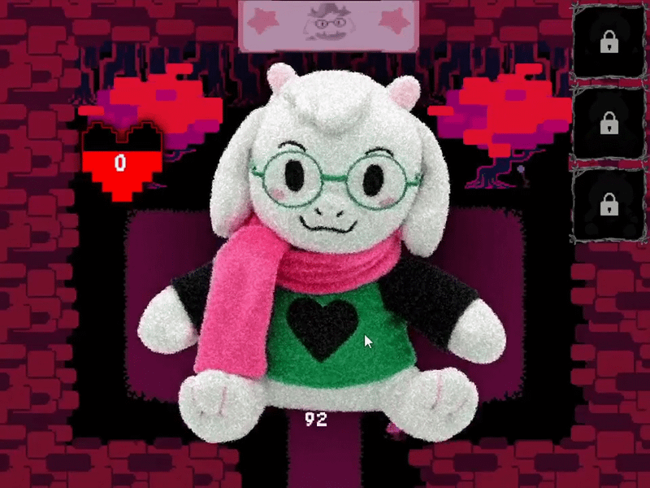
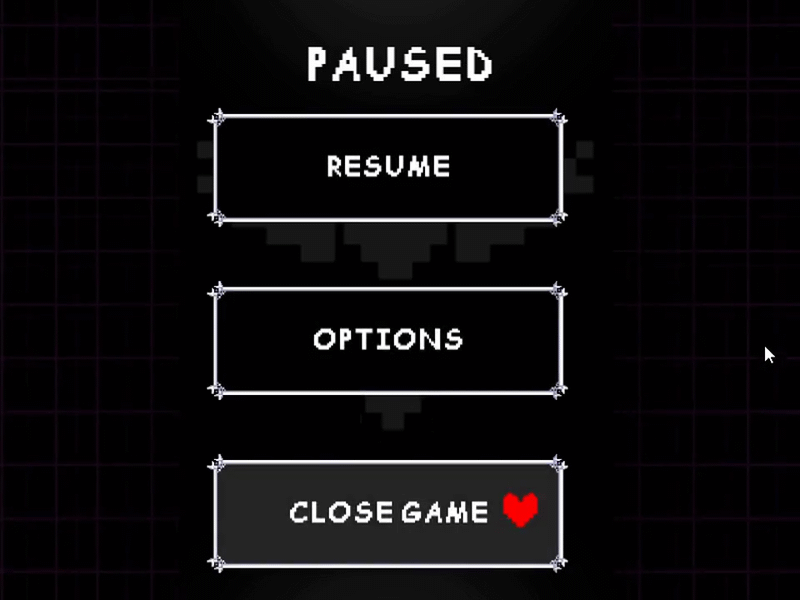
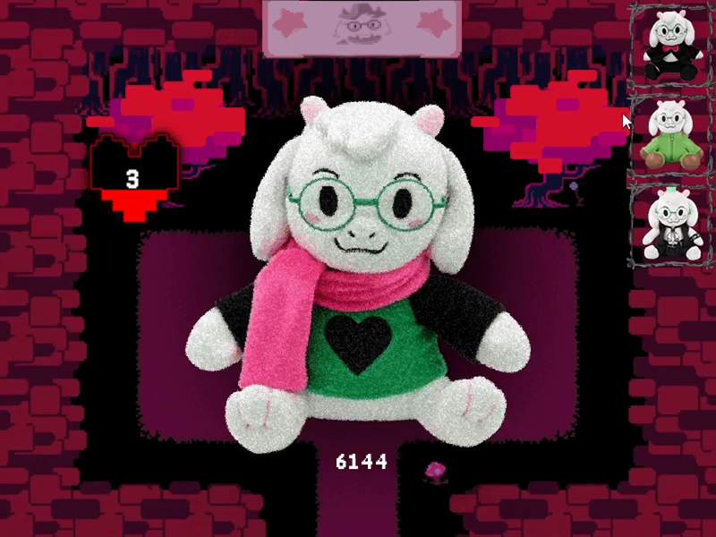

# Ralsei Clicker

A 2D Deltarune-inspired clicker written in C++ and SFML. 
Built as a personal learning project to practice OOP, memory management, and 2D graphics without a game engine.

<!--  -->

## Gameplay:




##Music:
Music on background made by **Alca Animusic on Piano**
Link: https://www.youtube.com/watch?v=iLAqGJpS9Tw


## Features

* Clicker gameplay with levels, scaling click power, and a progress indicator.
* Unlockable character skins tied to level progression.
* Auto-save and load functionality using a local text file (`Data/data.txt`).
* Pause and options menus with both mouse and keyboard support.
* Fullscreen toggle with aspect ratio preservation (letterboxing at 800×600).

## Controls

* **LMB / C** — Click
* **Z** — Open pause menu / Confirm
* **X** — Back / Close menu
* **↑ / ↓** — Navigate menus
* **Alt + Enter** — Toggle fullscreen
* **F1** — Reset progress manually
* **Num9** — Reset skin to default
* **Esc** — Quit

## Tech Stack & Implementation

* **Language & Library:** C++17, SFML (Graphics, Window, Audio).
* **Assets:** Centralized texture loading and storage via `AssetManager` using `std::unique_ptr`.
* **Architecture:** `Entity` and `Clickable` base classes, a `Scene` class handling object updates and rendering, and callback-based buttons via `std::function`.

## Build & Run (Windows / Visual Studio)

1. Clone the repository:
   ```bash
   git clone https://github.com/dakku7/deltarune_ralsei_clicker.git
2. Download SFML 2.6.2 matching your Visual Studio compiler (x64) from the official website.
3. Open clicker_ralsei.vcxproj in Visual Studio and set the SFML include and lib paths in the project properties.
4. Copy the required SFML .dll files into the build directory and make sure the Textures, Audio, and Data folders are in the working directory.
5. Build and run under the x64 configuration.
